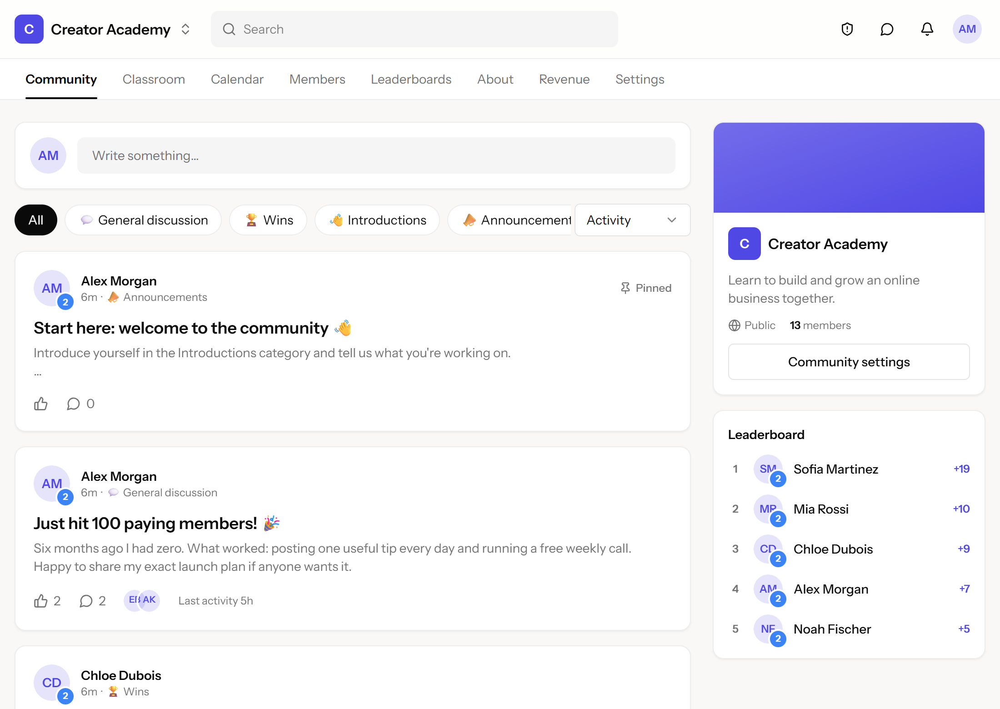
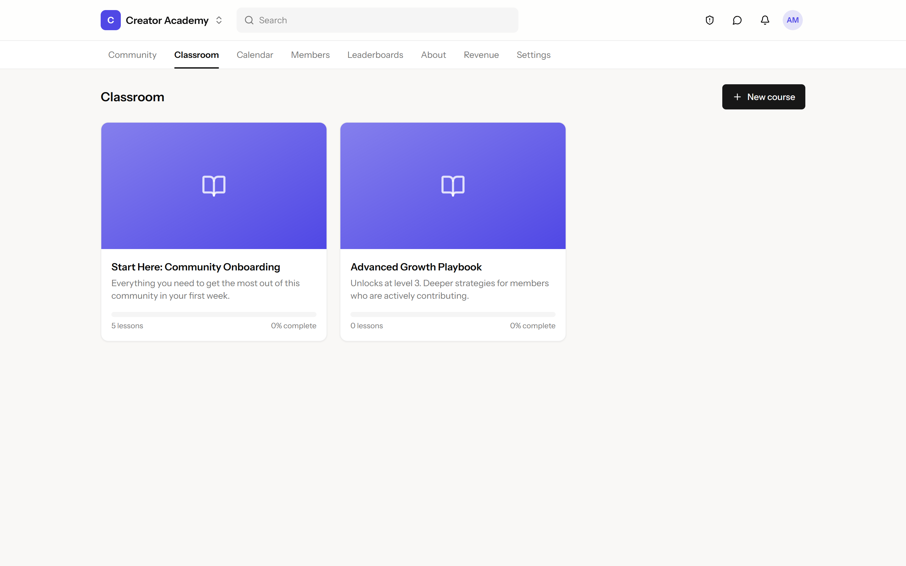
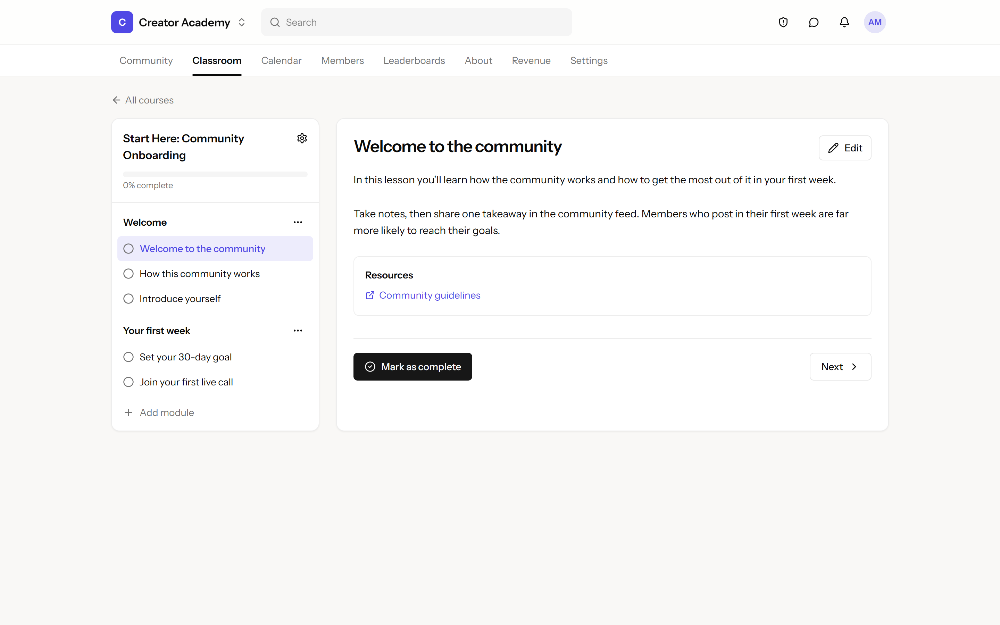
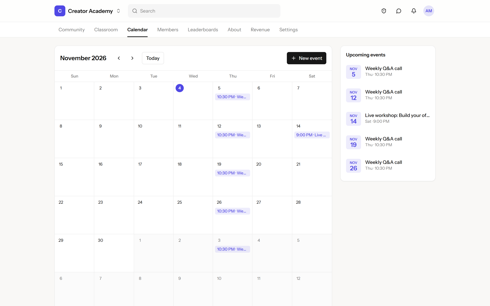
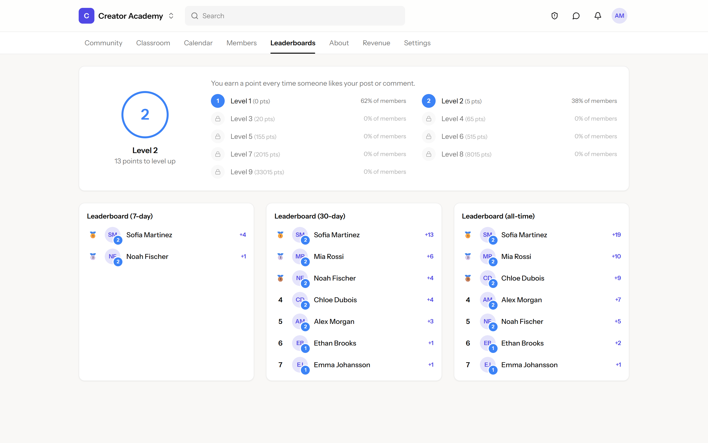
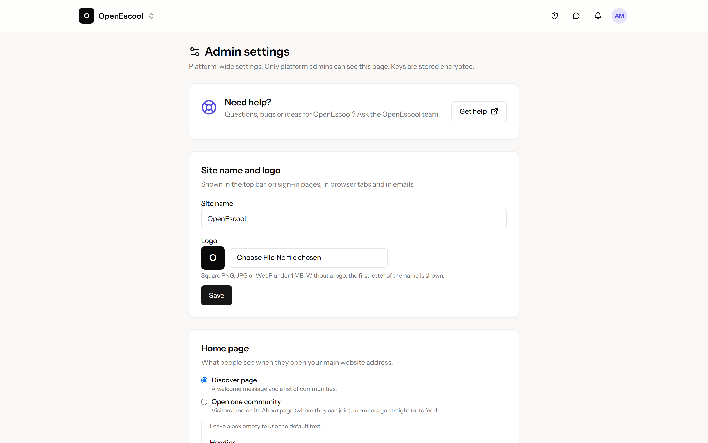
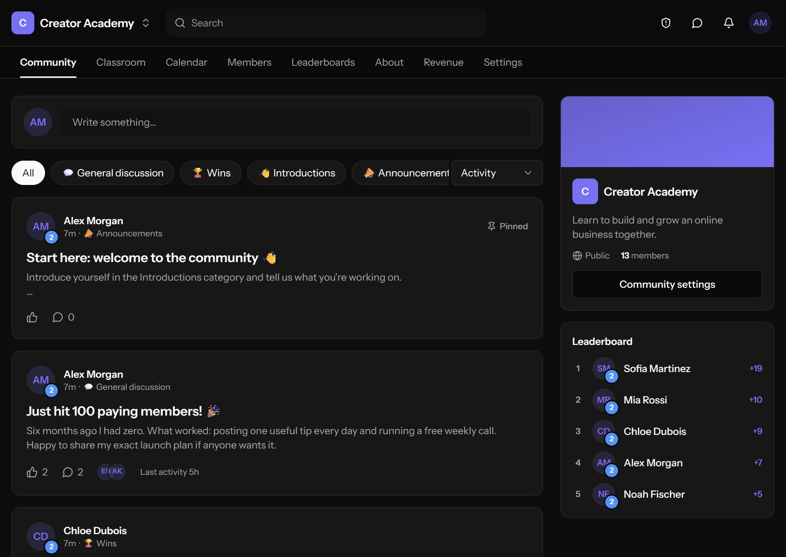
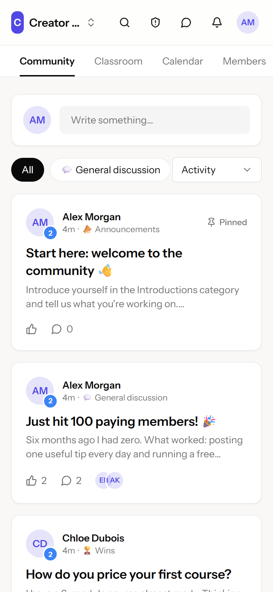

# OpenEscool

**Your own community platform, on your own server. Open source, unlimited communities, no monthly per-group fee.**

OpenEscool gives you everything you need to run paid or free online communities: a discussion feed, courses, events, leaderboards, chat and memberships, under your own name, logo and domain. It's an open-source alternative to Skool that you install once and own forever.

- 🌐 **Website:** see [openescool.amanverma.store](https://openescool.amanverma.store/)
- 🚀 **Install on Hostinger VPS:** [step-by-step guide](docs/INSTALL-HOSTINGER.md)
- 📖 **How everything works:** [guide](docs/GUIDE.md)
- 💬 **Help and ideas:** [openescool.userjot.com](https://openescool.userjot.com/)



---

## Screenshots

Real screens from a fresh install with demo data.

| Classroom | Lesson |
| --- | --- |
|  |  |
| **Calendar** | **Leaderboards** |
|  |  |
| **Admin settings** | **Dark mode** |
|  |  |

<p align="center"></p>

---

## Why OpenEscool

### Unlimited communities for the price of one server

Hosted platforms charge per community. Skool's Pro plan, for example, is $99 a month **for each group** ([check current pricing](https://www.skool.com/pricing)). With OpenEscool you pay only for your server: a small VPS runs **as many communities as you like**, with no platform fee on your sales.

### No competition inside your own platform

On a marketplace platform, your members browse and join other creators' groups from the same app. On OpenEscool, **every community belongs to you**. Members can only discover, join and switch between *your* communities, so the attention you earn stays with you. You can even make the home page open your main community directly.

### Your brand, your data, your rules

- Your **domain**, **site name** and **logo** everywhere: top bar, sign-in pages, browser tabs and emails.
- Your **database** on your server. Export, back up or move it whenever you want.
- Your **email list**: members are synced to your own Brevo contacts.
- **Open source**: change anything, add features, or hire anyone to do it for you.

---

## Features

**Community**
- Feed with categories, pinned posts, likes, comments, replies and @mentions
- Photos (up to 4 per post) and GIFs from GIPHY, in posts and comments, each switchable per community
- **Email a post to all members** in one click (with a 24-hour limit and an opt-out for members)
- Search across posts and members
- Members directory with online status, levels and roles
- About page with an image and video gallery, star ratings and reviews
- Join questions and admin approval for new members

**Courses (Classroom)**
- Courses → modules → lessons, with progress tracking
- Video lessons from YouTube, Vimeo or Loom, **or upload your own MP4 or WebM**
- **Downloadable lesson files** (PDF, Word, Excel, PowerPoint, ZIP, MP3…), served privately to members who have access
- Lock courses until members reach a level, or keep them for paying members

**Events (Calendar)**
- One-off and weekly events, email reminders, "Add to calendar" (.ics)

**Gamification**
- Points from likes, 9 levels with your own level names, 7-day / 30-day / all-time leaderboards
- Level-up notifications that unlock courses

**Payments**
- Monthly, yearly and one-time plans in USD, EUR, GBP, **INR**, AUD, CAD, SGD and AED
- **Stripe** worldwide and **Razorpay** for India (UPI, cards, netbanking, wallets)
- No platform fee on top of the payment gateway's own fee
- Revenue dashboard with MRR, receipts, a 3-day grace period for failed renewals

**Chat**
- Direct messages between members and your team (owner, admins, moderators)
- **Members can't message each other**, so nobody can quietly pull your members away
- Block, report, and email alerts for unread chats

**Email**
- Weekly or daily digest of the best posts and upcoming events
- Per-type email settings and one-click unsubscribe (meets Gmail and Yahoo bulk-sender rules)
- Sent through Brevo with just an API key, entered in the app

**Team and safety**
- Roles: owner, admin, moderator. Add your team from **Settings → Team**
- Your team can always post photos and GIFs, even where members can't
- Automatic spam protection: sign-up bot traps, link and keyword filters, chat-blast detection, a review queue and bans
- Rate limits on posts, comments and messages

**Site control (Admin settings)**
- Site name and logo
- Home page: open one community, or a Discover page with your own heading, text and featured communities
- **SEO**: turn search engines on or off for the whole site, per community, and per community's posts; automatic `sitemap.xml` and `robots.txt`
- Upload limits for photos, lesson files and videos
- **Updates**: see when a new version is out and update with one command (or one click)

---

## OpenEscool compared with Skool

| | OpenEscool | Skool |
| --- | --- | --- |
| Price | Free and open source; you pay only for hosting | $99/month per group on the Pro plan* |
| Number of communities | Unlimited on one server | Each group is billed separately* |
| Platform fee on sales | None | Transaction fee on each sale* |
| Other creators' groups shown to your members | Never; only your communities | Groups are listed on Skool's public Discovery page* |
| Your own domain, name and logo | Yes | Runs on skool.com* |
| Own and move your data | Yes, it's your database | Hosted by Skool |
| Change the code / add features | Yes | No |
| Razorpay and UPI for India | Yes | Not offered* |
| SEO on/off per community and per post | Yes | Not offered* |
| Members messaging each other | Off: chat is with your team only | Members can message each other by default* |
| Upload your own lesson videos | Yes | Yes |
| Courses, events, leaderboards, levels | Yes | Yes |

\* Based on Skool's public website and plans at the time of writing; they may change. Check [skool.com](https://www.skool.com/) for the latest.

*Skool is a trademark of its owner. OpenEscool is an independent open-source project and is not affiliated with, endorsed by, or sponsored by Skool.*

---

## Install

### On a Hostinger VPS (recommended)

Follow the **[Hostinger install guide](docs/INSTALL-HOSTINGER.md)**. It covers the whole setup in about 30 minutes: server, database, domain, free SSL and background jobs.

Need a server? **[Get a Hostinger VPS](https://www.hostg.xyz/aff_c?offer_id=6&aff_id=67383&url_id=3039)**.

**The first person to sign up on a new install becomes the admin.**

### On your computer (for development)

Requirements: PHP 8.2+, Composer, Node 20+. Locally the app uses SQLite.

```bash
composer install
npm install
cp .env.example .env
php artisan key:generate
php artisan migrate --seed   # demo data; log in as admin@example.com / password
php artisan storage:link
npm run build
php artisan serve
```

For live-reloading while you develop, run `npm run dev` next to `php artisan serve`. Emails are written to `storage/logs/laravel.log` until a Brevo key is saved. Run the tests with `php artisan test`.

### Updating

Back up first, then on your server:

```bash
php artisan app:update
```

Admin settings → Updates also shows when a new version is out. Details are in the [guide](docs/GUIDE.md#updating).

---

## Built with

Laravel 12, Inertia, React, TypeScript and Tailwind CSS. MySQL in production (SQLite locally), Brevo for email, Stripe and Razorpay for payments.

## Contributing and help

Found a bug or have an idea? Post it at [openescool.userjot.com](https://openescool.userjot.com/). Pull requests are welcome.

## Disclosure

See the [disclosure page](https://openescool.amanverma.store/disclosure).

## License

OpenEscool is licensed under the [GNU Affero General Public License v3.0](LICENSE) (AGPL-3.0).

In short: you can use it for free, run it for your own communities, change it and share it. If you run a modified version as a service for other people, you must make your modified source code available to them under the same licence.
